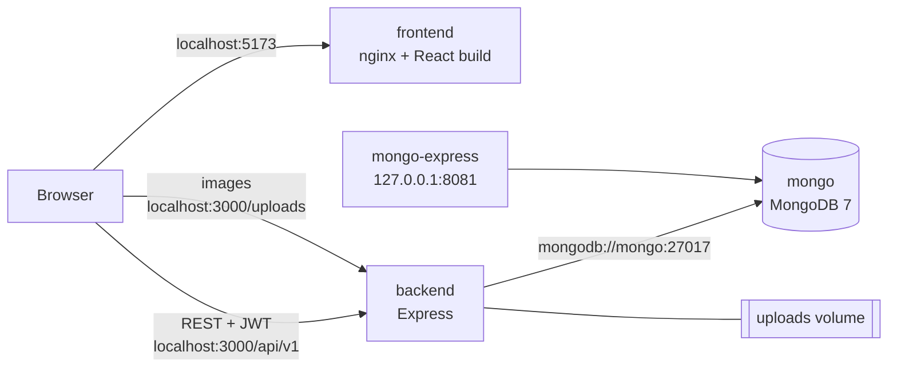

# Employee Manager - COMP3123 Assignment 2

Full stack employee management app: a React frontend on top of the Assignment 1 REST API, with search, profile picture upload, and Docker Compose.

- **Student:** Mehmet Emin Onem (101374462)
- **Course:** COMP3123 Full Stack Development I, George Brown Polytechnic
- **Deployment option:** Docker (Part III)

## Contents

- [Technologies](#technologies)
- [Architecture](#architecture)
- [Project structure](#project-structure)
- [Running with Docker (recommended)](#running-with-docker-recommended)
- [Running locally without Docker](#running-locally-without-docker)
- [Environment variables](#environment-variables)
- [API](#api)
- [Authentication and authorization](#authentication-and-authorization)
- [Security](#security)
- [Frontend](#frontend)
- [Logging and health check](#logging-and-health-check)
- [Testing](#testing)
- [Test credentials](#test-credentials)
- [Known limitations](#known-limitations)

## Technologies

| Layer | Stack |
|---|---|
| Frontend | React 19, Vite, React Router 7, Axios, React Bootstrap |
| Backend | Node.js 22, Express 5, Mongoose 9, JWT, bcrypt, multer |
| Security | Helmet, express-rate-limit, express-validator, CORS |
| Logging | winston, morgan |
| Database | MongoDB 7 |
| Containers | Docker Compose, nginx (serves the built frontend), mongo-express |

## Architecture



- nginx only serves the static React files. The React app runs in the browser and calls the backend API directly with Axios.
- The backend is the only service that talks to MongoDB. The `mongo` container has no published port, so the database cannot be reached from outside the Docker network.
- Profile pictures are stored on disk in a Docker volume (`uploads`) and served by the backend under `/uploads/<file>`. MongoDB only stores the path.
- mongo-express is an admin tool for viewing the data. It is bound to `127.0.0.1` and protected with basic auth.

## Project structure

```
.
├── docker-compose.yml        # mongo, mongo-express, backend, frontend
├── .env.example              # variables for docker compose
├── backend/
│   ├── Dockerfile
│   ├── server.js             # connects to MongoDB, then starts Express
│   ├── app.js                # middleware, routes, health check
│   ├── uploads/              # profile pictures (not committed)
│   ├── logs/                 # app.log (not committed)
│   └── src/
│       ├── config/db.js
│       ├── controllers/      # userController, employeeController
│       ├── middleware/       # auth, upload, validate, rateLimiter, errorHandler
│       ├── models/           # User, Employee
│       ├── routes/           # userRoutes, employeeRoutes
│       ├── utils/logger.js
│       └── validators/       # express-validator rules
├── frontend/
│   ├── Dockerfile            # build with Node, serve with nginx
│   ├── nginx.conf            # SPA fallback to index.html
│   └── src/
│       ├── api/              # axios client, auth and employee calls
│       ├── components/       # NavBar, ProtectedRoute, PublicOnlyRoute, Avatar, ConfirmDeleteModal
│       ├── context/          # AuthContext (session state)
│       ├── pages/            # Login, Signup, EmployeeList, EmployeeForm, EmployeeDetails, NotFound
│       └── utils/            # validation, formatting, error messages
├── postman/
│   ├── COMP3123_Assignment2.postman_collection.json
│   └── test-images/          # files used by the upload tests
└── screenshots/              # testing evidence
```

## Running with Docker (recommended)

Requirements: Docker Desktop.

```bash
git clone https://github.com/mehmetslayer/101374462_comp3123_assignment2_reactjs.git
cd 101374462_comp3123_assignment2_reactjs
cp .env.example .env          # then edit the values in .env
docker compose up --build -d
docker compose ps             # wait until backend and mongo are "healthy"
```

| Service | URL |
|---|---|
| React app | http://localhost:5173 |
| Backend API | http://localhost:3000/api/v1 |
| Health check | http://localhost:3000/health |
| mongo-express | http://localhost:8081 (login with `ME_USERNAME` / `ME_PASSWORD`) |

The database starts empty. Sign up in the app, or run the Postman collection, which creates its own test users.

Useful commands:

```bash
docker compose logs -f backend        # follow the backend logs
docker compose restart backend        # also resets the in-memory rate limit counters
docker compose down                   # stop, keep the data
docker compose down -v                # stop and delete the database, uploads and logs
```

## Running locally without Docker

Requirements: Node.js 22 and a MongoDB connection string (local MongoDB or Atlas).

```bash
# backend (terminal 1)
cd backend
cp .env.example .env          # set MONGODB_URI and JWT_SECRET
npm install
npm run dev                   # http://localhost:3000

# frontend (terminal 2)
cd frontend
cp .env.example .env
npm install
npm run dev                   # http://localhost:5173
```

## Environment variables

No real secrets are committed. Each folder has a `.env.example`.

**Root `.env`** (used by `docker compose`)

| Variable | Description |
|---|---|
| `JWT_SECRET` | Secret used to sign JWTs. Required, compose refuses to start without it. Use a long random string. |
| `ME_USERNAME` / `ME_PASSWORD` | Basic auth login for mongo-express. |
| `AUTH_RATE_LIMIT_MAX` | Signup + login requests allowed per IP per 15 minutes. Default 10. |

Compose sets the rest for the backend container: `PORT=3000`, `MONGODB_URI=mongodb://mongo:27017/comp3123_assignment2`, `CORS_ORIGIN=http://localhost:5173`. The frontend gets `VITE_API_URL=http://localhost:3000` as a build argument.

**`backend/.env`** (local run only)

| Variable | Description |
|---|---|
| `PORT` | Port of the API, default 3000. |
| `MONGODB_URI` | MongoDB connection string. |
| `JWT_SECRET` | Secret used to sign JWTs. |
| `AUTH_RATE_LIMIT_MAX` | Same as above. |
| `CORS_ORIGIN` | The only browser origin allowed to call the API, e.g. `http://localhost:5173`. |

**`frontend/.env`**

| Variable | Description |
|---|---|
| `VITE_API_URL` | Base URL of the backend, e.g. `http://localhost:3000`. Vite inlines it at build time. |

## API

Base URL: `http://localhost:3000/api/v1`. All employee routes need `Authorization: Bearer <token>`.

| Method | Path | Description | Success |
|---|---|---|---|
| POST | `/user/signup` | Create an account (`username`, `email`, `password`) | 201 |
| POST | `/user/login` | Log in with `username` or `email` plus `password`, returns a JWT | 200 |
| GET | `/emp/employees` | List the logged-in user's employees | 200 |
| GET | `/emp/employees/search?department=&position=` | Search the user's employees | 200 |
| POST | `/emp/employees` | Create an employee, optional picture | 201 |
| GET | `/emp/employees/:eid` | Get one employee | 200 |
| PUT | `/emp/employees/:eid` | Update an employee, optional new picture | 200 |
| DELETE | `/emp/employees?eid=<id>` | Delete an employee and its picture | 204 |
| GET | `/health` (no `/api/v1`) | Server and database status | 200 |
| GET | `/uploads/<file>` (no `/api/v1`) | A stored profile picture | 200 |

Employee fields: `first_name`, `last_name`, `email`, `position`, `salary`, `date_of_joining`, `department`, `profile_picture`. The `user` field links each employee to its owner and is set by the server from the JWT.

Error codes: `400` validation error or bad id, `401` missing, invalid or expired token, or wrong login, `404` not found (also for another user's employee), `409` duplicate username or email, `429` rate limit, `500` server error. Validation errors return `{ message, errors: [{ field, message }] }`.

### Search

- At least one of `department` or `position` is required, otherwise `400`. Each is at most 100 characters.
- Matching is partial and case-insensitive: `position=develop` finds "Senior Developer".
- If both are given, both must match.
- User input is escaped before it is used in the regular expression, so `department=.*` is treated as text and does not match everything.
- Results only include the logged-in user's employees.

### Profile picture upload

- `POST` and `PUT` accept `multipart/form-data` with the employee fields as text and the image in a `profile_picture` field. JSON bodies still work when there is no picture.
- Allowed types: JPEG, PNG, WebP. Maximum size: 2 MB. Anything else returns `400` with a clear message.
- The file gets a random UUID name, so user-supplied file names are never used on disk.
- The response contains the path, for example `"profile_picture": "/uploads/8286aae7-....png"`.
- If validation fails or the employee is not found, the uploaded file is deleted. When a picture is replaced, the old file is deleted. When an employee is deleted, its picture is deleted.

## Authentication and authorization

1. **Signup:** the password is hashed with bcrypt (10 salt rounds) before it is saved. It is never returned in responses.
2. **Login:** the server compares the password with bcrypt and returns a JWT signed with `JWT_SECRET`, valid for 1 hour. Wrong username and wrong password give the same `401` message.
3. **Frontend storage:** the token and username are stored in `localStorage`, so the session survives a page refresh. Logout clears them and redirects to `/login`.
4. **Sending the token:** an Axios request interceptor adds `Authorization: Bearer <token>` to every API request.
5. **Verifying the token:** the `auth` middleware verifies the JWT, loads the user from the database, and sets `req.user`. The user id always comes from the token, never from the request body.
6. **Ownership:** every employee query includes the owner, for example `findOne({ _id: eid, user: req.user._id })`. A user who requests another user's employee gets `404`, not `403`, so the API does not reveal whether that id exists. This applies to view, update, delete and search, even when the id is typed directly into the URL.
7. **Expired or invalid token:** a `401` on a request that carried a token clears the session. The app then redirects to `/login` and shows "Your session expired. Please log in again."

## Security

- **Passwords:** bcrypt hashes. The password field is excluded from queries by default.
- **JWT:** 1 hour expiry, secret only in environment variables.
- **Helmet:** sets secure HTTP headers. `crossOriginResourcePolicy` is set to `cross-origin` only so the React app on port 5173 can show images from port 3000.
- **Rate limiting:** signup and login share a limit of `AUTH_RATE_LIMIT_MAX` requests (default 10) per 15 minutes per IP. All `/api` routes have a general limit of 100 per 15 minutes. Both return `429`, and the UI shows "Too many attempts. Please wait a few minutes and try again."
- **Input validation:** express-validator on every route (types, lengths, email format, salary of 0 or more, ISO date, valid ObjectId). String type checks also block NoSQL operator injection such as `{ "$ne": null }`. The React forms use the same rules, so most errors are caught before a request is sent.
- **CORS:** only `CORS_ORIGIN` may call the API from a browser, with only the needed methods and headers.
- **File uploads:** type allow-list, 2 MB limit, one file per request, random file names, cleanup of unused files.
- **Environment variables:** `.env` files are in `.gitignore`. Only `.env.example` files with placeholders are committed.
- **Database exposure:** MongoDB is not published to the host. mongo-express listens on `127.0.0.1` only and needs a password.
- **Errors:** a central error handler returns generic messages for unexpected errors, so stack traces are not sent to the client.

## Frontend

**Routes**

| Path | Page | Access |
|---|---|---|
| `/` | Redirects to `/employees` | - |
| `/login` | Login with username or email | Logged out only |
| `/signup` | Create an account | Logged out only |
| `/employees` | Employee list with search, view, edit, delete | Logged in |
| `/employees/add` | Add employee form with picture | Logged in |
| `/employees/:id` | Employee details | Logged in |
| `/employees/:id/edit` | Edit employee form | Logged in |
| `*` | Not found page | - |

`ProtectedRoute` redirects to `/login` when there is no session. `PublicOnlyRoute` redirects logged-in users away from login and signup.

**Main parts**

- `AuthContext` holds the token and username, exposes `login` and `logout`, and listens for the `auth:expired` event from the Axios client.
- `api/client.js` is the shared Axios instance: base URL from `VITE_API_URL`, request interceptor for the token, response interceptor for expired sessions.
- `EmployeeForm` is used for both add and edit. It validates fields, checks the image type and size before upload, shows a preview, and sends `FormData`.
- `EmployeeList` shows the table, the search form (department and/or position), result counts, empty states, and a confirmation modal before deleting.
- `utils/errorMessage.js` turns API errors (network, 400, 401, 404, 409, 429, 500) into short messages for the user.

## Logging and health check

**Logs:** winston writes to the console and to `backend/logs/app.log` (in Docker, the `backend-logs` volume at `/app/logs`).

- Logged: every request (method, URL, status, response time), signup and login success or failure, validation failures, auth failures (no token, invalid, expired), rate limit hits, and server errors.
- Not logged: passwords, tokens, `Authorization` headers, or request bodies.

```bash
docker compose logs backend --tail 20
docker compose exec backend tail -n 20 /app/logs/app.log
```

**Health check:** `GET http://localhost:3000/health`

```json
{
  "status": "ok",
  "uptime": 123.45,
  "timestamp": "2026-11-18T23:00:00.000Z",
  "database": "connected"
}
```

Docker also uses this endpoint for the backend container's healthcheck. The frontend only starts once the backend is healthy.

## Testing

**Postman:** import `postman/COMP3123_Assignment2.postman_collection.json` and run it with the Collection Runner (58 requests, 73 tests).

1. In Postman, set Settings > General > Working directory to this repo's `postman/` folder. The upload tests read their files from `postman/test-images/`.
2. Signup and login share the auth rate limit, so for a full run set `AUTH_RATE_LIMIT_MAX=100` in the root `.env` and run `docker compose up -d`. Set it back to 10 afterwards.
3. Run `docker compose restart backend` before each run. One run sends 58 requests and the general limit is 100 per 15 minutes.

The collection covers the Assignment 1 tests (auth, CRUD, validation, JWT errors, cross-user `404`s) plus search (partial match, both fields, no results, regex escaping, missing parameters, owner-only results) and picture upload (success, fetching the image, wrong type, too large, replacing and deleting).

**UI:** both success and failure scenarios were tested in the browser with two users. See `screenshots/`.

## Test credentials

The Docker database starts empty, so there are no fixed accounts. Either:

- run the Postman collection, which creates `postmanA` and `postmanB` with password `Test12345`, or
- sign up two users in the app, for example `userA` / `userA@mail.com` / `Test12345` and `userB` / `userB@mail.com` / `Test12345`.

## Known limitations

- Rate limit counters are kept in memory, so they reset when the backend restarts and would not be shared between several backend instances.
- The upload check uses the MIME type sent by the client. It does not inspect the file contents (magic bytes).
- MongoDB in Docker runs without authentication. It is only reachable inside the Docker network, but a production setup should enable it.
- The JWT is kept in `localStorage`, which is simple but readable by any script on the page. An httpOnly cookie would be safer against XSS.
- There is no refresh token. After 1 hour the user has to log in again.
- No automated unit tests. Testing is done with Postman and manually through the UI.